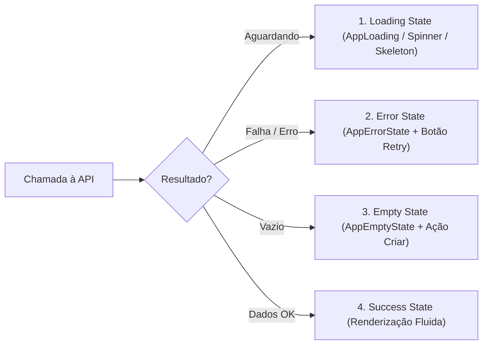

# Salon Manager — Design System & Visual Guidelines

**Versão**: 1.0.0  
**Status**: Oficial  
**Padrão Estético**: SaaS Boutique Contemporâneo  
**Público-Alvo**: Recepcionistas, gerentes, proprietários e profissionais de beleza e bem-estar

---

## 1. Filosofia e Identidade Visual

O **Salon Manager** adota a linguagem visual **SaaS Boutique Contemporâneo**. O objetivo é equilibrar a elegância e o acolhimento do universo da beleza e bem-estar com a velocidade, precisão e densidade de informação exigidas por uma operação comercial profissional.

### Pilares Fundamentais:

1. **Sofisticação Autoral (Anti-Slop)**: Rejeitamos padrões genéricos gerados por inteligência artificial — sem gradientes roxos/azuis artificiais, sem ilustrações 3D flutuantes desnecessárias e sem sombras pesadas. A interface deve parecer desenhada especificamente para este salão.
2. **Clareza Operacional e Densidade Equilibrada**: A recepção de um salão é dinâmica e ágil. Informações críticas (horários, status de atendimento, comanda, valores financeiros) devem ter leitura imediata com tipografia legível e contrastes nítidos.
3. **Harmonia Orgânica e Nobre**: O diálogo entre o **Vinho Nobre** (`#7B3F61`) e o **Champagne Dourado** (`#C59B6D`) confere exclusividade e sensação de cuidado premium.
4. **Respeito aos Quatro Estados de Interface (NON-NEGOTIABLE)**: Toda listagem, tabela, modal ou seção de dados assíncronos deve obrigatoriamente prever e implementar estados de _Carregamento_, _Vazio_, _Erro com Ação_ e _Sucesso_.

---

## 2. Paleta de Cores e Tokens Semânticos

A paleta é construída sobre variáveis SCSS e tokens semânticos suportados pelo Quasar Framework e Tailwind-like CSS, com alternância completa entre **Light Mode** e **Dark Mode**.

### 2.1. Cores de Identidade da Marca

| Token SCSS   | Valor HEX |                             Amostra                             | Finalidade                                                                                                                    |
| :----------- | :-------- | :-------------------------------------------------------------: | :---------------------------------------------------------------------------------------------------------------------------- |
| `$primary`   | `#7B3F61` |  | **Vinho Nobre**: Cor primária institucional, botões de ação principal, destaques ativos e cabeçalhos de destaque.             |
| `$secondary` | `#C59B6D` |  | **Champagne Dourado**: Cor secundária de requinte, acentos em comissões, badges financeiros e botões de destaque alternativo. |
| `$accent`    | `#9E7B9B` |  | **Lavanda Suave**: Destaques terciários, tags contextuais e estados sutis.                                                    |

### 2.2. Cores Semânticas de Negócio

| Token SCSS  | Valor HEX |                             Amostra                             | Significado no Sistema                                                                           |
| :---------- | :-------- | :-------------------------------------------------------------: | :----------------------------------------------------------------------------------------------- |
| `$positive` | `#2A9D8F` |  | **Sucesso**: Receitas financeiras, status `CONCLUIDO`, confirmações e saldo positivo.            |
| `$negative` | `#E76F51` |  | **Erro / Perigo**: Despesas financeiras, cancelamentos, status `CANCELADO` e ações destrutivas.  |
| `$info`     | `#457B9D` |  | **Informativo**: Status inicial `AGENDADO`, avisos de contexto e dados informativos.             |
| `$warning`  | `#E9C46A` |  | **Atenção / Em Progresso**: Status `EM_ATENDIMENTO`, alertas operacionais e avisos de pendência. |

### 2.3. Cores Semânticas do Ciclo de Vida dos Agendamentos

| Status           | Cor                              |    Borda Lateral    | Badge                                 |
| :--------------- | :------------------------------- | :-----------------: | :------------------------------------ |
| `AGENDADO`       | `#457B9D` (Info / Azul Suave)    | `4px solid #457B9D` | Fundo suave com texto em azul         |
| `CONFIRMADO`     | `#7B3F61` (Primária / Vinho)     | `4px solid #7B3F61` | Fundo suave com texto em vinho        |
| `EM_ATENDIMENTO` | `#E9C46A` (Warning / Âmbar)      | `4px solid #E9C46A` | Fundo suave com texto em âmbar escuro |
| `CONCLUIDO`      | `#2A9D8F` (Positivo / Esmeralda) | `4px solid #2A9D8F` | Fundo suave com texto em verde        |
| `CANCELADO`      | `#E76F51` (Negativo / Coral)     | `4px solid #E76F51` | Fundo suave com texto em vermelho     |
| `NAO_COMPARECEU` | `#673AB7` (Roxo Profundo)        | `4px solid #673AB7` | Fundo suave com texto em roxo         |
| **BLOQUEIO**     | `#757575` (Cinza Hachurado)      | `4px solid #757575` | Fundo hachurado com ícone de cadeado  |

### 2.4. Superfícies e Modo Escuro (Dark Mode)

| Elemento                       | Light Mode                      | Dark Mode (`body.body--dark`)         |
| :----------------------------- | :------------------------------ | :------------------------------------ |
| **Fundo da Página**            | `#F8F9FA`                       | `#0D0E11`                             |
| **Fundo de Cards / Modais**    | `#FFFFFF`                       | `#15171C`                             |
| **Fundo de Cards Secundários** | `#FFFFFF`                       | `#181A20`                             |
| **Bordas Estruturais**         | `1px solid rgba(0, 0, 0, 0.06)` | `1px solid rgba(255, 255, 255, 0.06)` |
| **Texto Primário**             | `#1A1A1A`                       | `#F0F0F0`                             |
| **Texto Secundário / Legenda** | `#666666`                       | `#A0A0A0`                             |

---

## 3. Tipografia

A família tipográfica oficial exclusiva do projeto é **Plus Jakarta Sans** (Google Fonts).

### 3.1. Escala Tipográfica e Hierarquia

| Estilo / Classe  | Tamanho |      Peso       | Line-Height | Uso Recomendado                                                     |
| :--------------- | :-----: | :-------------: | :---------: | :------------------------------------------------------------------ |
| `text-h4`        |  34px   |   Bold (700)    |     1.2     | Destaques executivos e indicadores-chave do Dashboard               |
| `text-h5`        |  24px   |   Bold (700)    |     1.3     | Títulos de páginas e seções principais (ex: "Catálogo de Serviços") |
| `text-subtitle1` |  16px   | Semi-Bold (600) |     1.4     | Títulos de modais, cabeçalhos de cards e destaques de tabela        |
| `text-body1`     |  15px   |  Regular (400)  |     1.5     | Parágrafos de leitura, descrições longas e textos contextuais       |
| `text-body2`     |  14px   | Regular/Medium  |     1.5     | Texto padrão de tabelas, formulários e listas de itens              |
| `text-caption`   |  12px   | Regular/Medium  |     1.4     | Dicas de formulário (_hints_), legendas, metadados e badges         |

### 3.2. Regra de Formatação Numérica Financeira

- Valores monetários e quantitativos MUST utilizar a classe `.text-currency` com a propriedade CSS:
  ```css
  font-variant-numeric: tabular-nums;
  ```
- Isso garante que números em tabelas e cards permaneçam com alinhamento vertical estrito independentemente dos dígitos exibidos.

---

## 4. Escala de Espaçamento e Alinhamento

O sistema de espaçamento baseia-se em uma grade geométrica de **4px e 8px**.

| Token / Espaço | Valor | Utilização                                                       |
| :------------: | :---: | :--------------------------------------------------------------- |
|      `xs`      |  4px  | Gaps internos de badges, ícones junto a textos curtos            |
|      `sm`      |  8px  | Padding interno de inputs densos, gaps de botões e chips         |
|      `md`      | 16px  | Espaçamento padrão entre campos de formulário, paddings de cards |
|      `lg`      | 24px  | Padding padrão de páginas (`q-pa-lg`) e separadores de seções    |
|      `xl`      | 32px  | Distância entre blocos independentes e seções de topo            |
|     `xxl`      | 48px  | Espaçamento de grandes seções ou estados de tela vazia           |

### Regra de Alinhamento:

- **Bordas Iguais**: Elementos adjacentes devem manter margens e paddings simétricos. Em grades e tabelas, a margem esquerda e direita do conteúdo deve alinhar-se perfeitamente com os cabeçalhos de seção.

---

## 5. Bordas, Sombras e Elevação

### 5.1. Raio de Arredondamento (Border Radius)

- **Controles, Botões e Inputs**: `8px` (`border-radius: 8px`).
- **Cards, Tabelas e Diálogos**: `12px` (`border-radius: 12px`).
- **Chips, Badges e Pílulas**: `16px` ou `round` / `rounded` (estilo pílula).

### 5.2. Sombras e Elevações

O design boutique prioriza profundidade por contraste sutil de borda ao invés de sombras escuras.

- **Card Padrão**:
  ```scss
  box-shadow:
    0 1px 3px 0 rgba(0, 0, 0, 0.05),
    0 1px 2px -1px rgba(0, 0, 0, 0.05);
  border: 1px solid rgba(0, 0, 0, 0.06);
  ```
- **Hover de Cards Clicáveis**:
  ```scss
  transition:
    transform 0.2s ease,
    box-shadow 0.2s ease;
  &:hover {
    transform: translateY(-1px);
    box-shadow: 0 4px 8px 0 rgba(0, 0, 0, 0.08);
  }
  ```

---

## 6. Componentes de Interface e Formulários

### 6.1. Biblioteca Oficial de Ícones

- A biblioteca exclusiva do projeto é **Lucide Icons** (`lucide-vue-next`).
- Não é permitido importar `@lucide/vue`, classes de Material Icons em texto puro (`<i class="material-icons">`) ou FontAwesome.
- Tamanhos recomendados:
  - Ícone de botão de ação: `16px` ou `18px`.
  - Ícone de campo de entrada (_prepend_): `18px`.
  - Ícone de stat card / indicador: `24px` a `28px`.
  - Ícone de empty state: `48px` a `56px`.

### 6.2. Botões (`q-btn`)

- **Texto**: `text-transform: none` (proibido forçar caixa alta com `uppercase`).
- **Botão Primário**: `unelevated color="primary" no-caps` (Vinho Nobre).
- **Botão Secundário / Alternativo**: `outline color="primary" no-caps` ou `color="secondary"`.
- **Botão Terciário / Cancelar**: `flat color="grey-7" no-caps`.
- **Botão Destrutivo / Negativo**: `unelevated color="negative" no-caps`.
- **Acessibilidade Móvel**: Alvo de clique mínimo de **44px de altura** em telas móveis e tablets.

### 6.3. Campos de Entrada e Formulários (`q-input`, `q-select`)

- Padrão visual: `outlined`, `dense`, com `border-radius: 8px`.
- Rótulos (_labels_) claros com asterisco em campos obrigatórios (`Nome do Cliente *`).
- Ícones semânticos anexados no slot `#prepend` para rápida identificação cognitiva.
- Campos de busca com debounce configurado: `input-debounce="300"`.
- Validações em linha com mensagens humanizadas e explicativas em português (pt-BR).

### 6.4. Tabelas de Dados (`q-table`)

- Utilizar o composable compartilhado `usePaginationTable`.
- Cabeçalhos alinhados semanticamente: textos à esquerda (`left`), valores monetários e numéricos à direita (`right`), badges e status no centro (`center`).
- Exibir indicador de carregamento Quasar (`:loading="loading"`).

---

## 7. Os Quatro Estados Obrigatórios de Interface (NON-NEGOTIABLE)

Qualquer tela ou componente que consuma dados assíncronos da API deve obrigatoriamente prever:



1. **Loading State**: `q-spinner-tail color="primary"` ou `q-skeleton` contextuais. Nunca deixar a tela travada ou sem resposta visual durante requisições.
2. **Empty State**: Componente [`AppEmptyState`](file:///home/debhg/Projetos/salon-manager-frontend/src/components/common/AppEmptyState.vue) com título claro, explicação concisa e botão de ação primária (ex: "Novo Agendamento" ou "Cadastrar Primeiro Cliente").
3. **Error State**: Componente [`AppErrorState`](file:///home/debhg/Projetos/salon-manager-frontend/src/components/common/AppErrorState.vue) informando o ocorrido de forma transparente com botão de retentativa imediata ("Tentar Novamente").
4. **Success State**: Exibição estruturada dos dados com badges semânticos e formatação adequada.

---

## 8. Diretrizes de Acessibilidade (WCAG AA) e Responsividade

### 8.1. Acessibilidade

- **Contraste de Cores**: Relação de contraste mínima de **4.5:1** para textos padrão e **3:1** para textos grandes (acima de 18px ou bold 14px), tanto no tema claro quanto escuro.
- **Não Depender Apenas de Cor**: Todo indicador de status deve combinar cor com texto explícito ou ícone representativo (ex: badge com texto "Concluído" além da cor verde).
- **Navegação por Teclado**: Todo botão, link e campo interativo deve apresentar contorno de foco visível (`focus-visible`) com contraste nítido.
- **Alvos de Toque (Touch Targets)**: Elementos clicáveis devem possuir dimensões mínimas de **44px $\times$ 44px** em dispositivos com tela de toque.

### 8.2. Breakpoints e Responsividade

- **Mobile (`< 768px`)**: Grids colapsam para visualização em coluna única vertical; formulários ajustam campos em largura total (`col-12`); tabelas e grades semanais utilizam rolagem horizontal fluida (`overflow-x: auto`).
- **Tablet (`768px - 1023px`)**: Grids operam em 2 colunas (`col-sm-6`); menus e gavetas de navegação recolhem sob demanda.
- **Desktop (`>= 1024px`)**: Visualização multi-colunas de alta densidade produtiva com barra lateral fixa.
