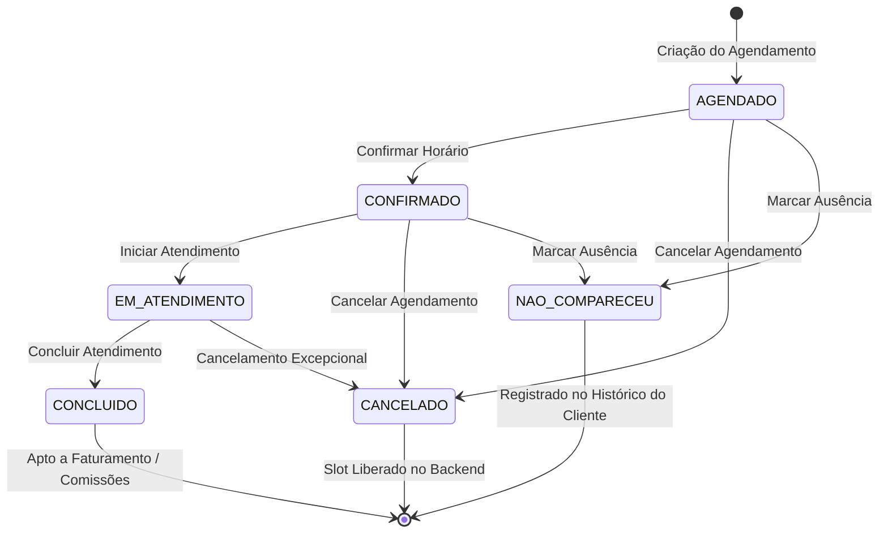

# Data Model: Motor de Agendamentos e Agenda Visual

**Feature**: `002-appointments-agenda`  
**Date**: 2026-11-14  
**Status**: Completed

---

## 1. Entidades Principais

### 1.1. Appointment (`AppointmentResponse`)

Representa o compromisso agendado entre um cliente e um profissional para a execução de um procedimento estético.

| Campo          | Tipo                | Obrigatório | Descrição                             | Regras de Validação                              |
| :------------- | :------------------ | :---------: | :------------------------------------ | :----------------------------------------------- |
| `id`           | `string`            |     Sim     | Identificador único (UUID)            | Formato UUID v4                                  |
| `employeeId`   | `string`            |     Sim     | ID do profissional executor           | Deve referenciar colaborador ativo               |
| `employeeName` | `string`            |     Sim     | Nome de exibição do profissional      | Não vazio                                        |
| `clientId`     | `string`            |     Sim     | ID do cliente atendido                | Deve referenciar cliente ativo                   |
| `clientName`   | `string`            |     Sim     | Nome de exibição do cliente           | Não vazio                                        |
| `serviceId`    | `string`            |     Sim     | ID do serviço/procedimento            | Deve referenciar serviço cadastrado              |
| `serviceName`  | `string`            |     Sim     | Nome do serviço                       | Não vazio                                        |
| `startTime`    | `string`            |     Sim     | Início do atendimento em ISO 8601 UTC | Formato ISO 8601 UTC (`YYYY-MM-DDTHH:mm:ssZ`)    |
| `endTime`      | `string`            |     Sim     | Término estimado em ISO 8601 UTC      | Calculado: `startTime + service.durationMinutes` |
| `price`        | `number`            |     Sim     | Preço contratado do procedimento (R$) | Valor numérico $\ge 0$                           |
| `status`       | `AppointmentStatus` |     Sim     | Estado do ciclo de vida operacional   | Enum com 6 valores válidos                       |
| `notes`        | `string`            |     Não     | Observações ou preferências           | Máximo 500 caracteres                            |
| `version`      | `number`            |     Sim     | Versão do registro (Optimistic Lock)  | Inteiro $\ge 0$                                  |
| `createdAt`    | `string`            |     Não     | Timestamp de criação                  | ISO 8601                                         |
| `updatedAt`    | `string`            |     Não     | Timestamp da última modificação       | ISO 8601                                         |

---

### 1.2. TimeSlot (`TimeSlot`)

Representa uma fatia de tempo na agenda de um colaborador para uma data e serviço específicos.

| Campo       | Tipo      | Obrigatório | Descrição                                                        |
| :---------- | :-------- | :---------: | :--------------------------------------------------------------- |
| `startTime` | `string`  |     Sim     | Horário de início do intervalo (formato `HH:mm`, ex: `"14:00"`)  |
| `endTime`   | `string`  |     Sim     | Horário de término do intervalo (formato `HH:mm`, ex: `"14:45"`) |
| `available` | `boolean` |     Sim     | `true` se o profissional estiver livre para alocação             |

---

### 1.3. Estado Reativo de Navegação (`AgendaNavigationState`)

Controla os parâmetros de visualização e filtros temporais da agenda.

```typescript
export interface AgendaNavigationState {
  viewMode: 'day' | 'week';
  selectedDate: string; // Formato YYYY-MM-DD
  selectedEmployeeId: string | null; // null = Todos os colaboradores
}
```

---

### 1.4. Modelo de Formulário de Agendamento (`AppointmentFormData`)

Utilizado no modal de criação rápida para validação reativa antes do envio à API.

```typescript
export interface AppointmentFormData {
  clientId: string | null;
  employeeId: string | null;
  serviceId: string | null;
  date: string; // YYYY-MM-DD
  time: string; // HH:mm
  notes?: string;
}
```

---

## 2. Ciclo de Vida e Transições de Status (`AppointmentStatus`)



### Regras de Transição de Estado

1. **`AGENDADO`**:
   - Estado inicial padrão de todo agendamento.
   - Permite transição para: `CONFIRMADO`, `CANCELADO`, `NAO_COMPARECEU`.
2. **`CONFIRMADO`**:
   - Acionado quando o cliente confirma presença (por WhatsApp, telefone ou balcão).
   - Permite transição para: `EM_ATENDIMENTO`, `CANCELADO`, `NAO_COMPARECEU`.
3. **`EM_ATENDIMENTO`**:
   - Acionado quando o cliente senta na cadeira do profissional e o procedimento tem início.
   - Permite transição para: `CONCLUIDO`, `CANCELADO`.
4. **`CONCLUIDO`**:
   - Estado terminal de sucesso operacional.
   - Habilita o agendamento para cobrança e cômputo de comissão no módulo financeiro.
5. **`CANCELADO`**:
   - Estado terminal de cancelamento.
   - Libera o slot no backend para novos atendimentos.
6. **`NAO_COMPARECEU`**:
   - Estado terminal de no-show (cliente ausente sem aviso prévio).
